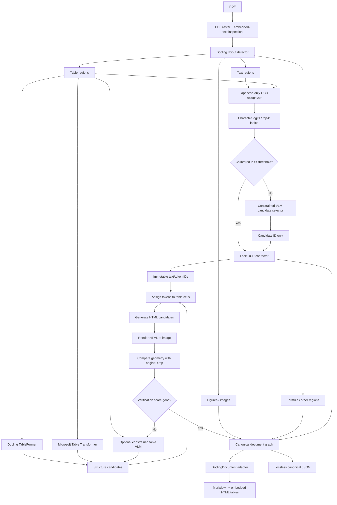
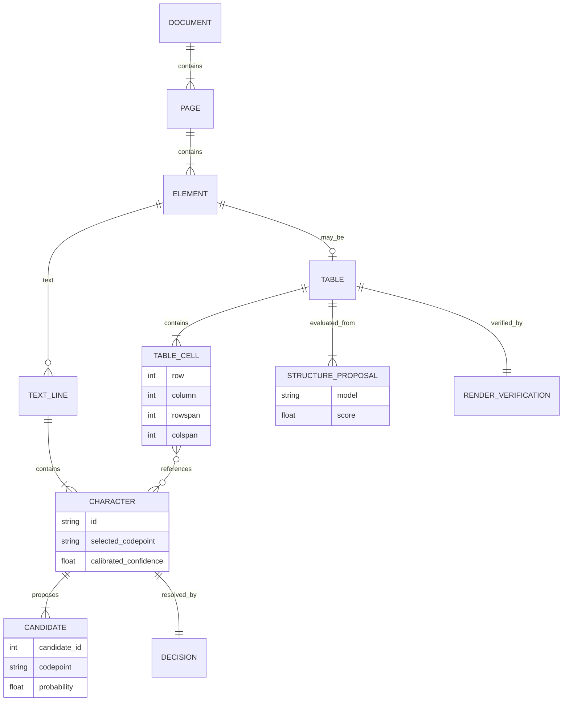

# Building a World-Class Docling-Based Japanese PDF-to-Markdown Pipeline

## Executive summary

The strongest design for your requirements is **not** a monolithic PDF-to-Markdown VLM. It is a **Docling-orchestrated, evidence-preserving hybrid pipeline** in which Japanese text recognition, document geometry, table structure, and contextual correction are deliberately separated.

Docling is a particularly good foundation because it is MIT-licensed, runs locally, has a modular document pipeline, exposes a unified `DoclingDocument`, supports interchangeable OCR engines, contains its own layout and table models, and has customizable serializers. Its current model stack includes RT-DETR-family layout models, multiple OCR backends, TableFormer, and VLM-based table/document processing. citeturn3view2turn3view4turn3view0

My recommended production architecture is:

> **Docling layout → Japanese-only recognizer → calibrated character lattice → deterministic high-confidence acceptance → constrained visual/contextual candidate selection → dual table-structure proposal → immutable OCR-token table reconstruction → render-and-compare verification → Docling document reconstruction → Markdown with HTML tables.**

The most important architectural decision is this:

**Do not allow a VLM to generate Japanese text.**

Let the Japanese OCR recognizer be the *only* component permitted to propose Unicode characters. For uncertain positions, the VLM receives candidate IDs such as `[0, 2, 1, 0]` and is only allowed to choose among them. The final Unicode string is assembled deterministically afterward.

This changes Japanese→Chinese leakage from a fuzzy model-quality problem into a constrained-search problem. A VLM cannot spontaneously emit `这`, `体`, or some visually related Simplified Chinese form if those characters are absent from the candidate lattice. The remaining failure mode is then **candidate-set error**—the correct Japanese character was not present in top-*k*—which is measurable as `Recall@k` and can be directly optimized during OCR training.

For tables, use the same principle:

> **OCR owns text; the table model/VLM owns geometry.**

Do not ask the table VLM to produce `<td>株式会社...</td>`. Give it immutable OCR token IDs and ask it to produce only rows, columns, cell membership, `rowspan`, and `colspan`. Then reconstruct HTML deterministically. Docling's own serialization documentation makes this especially important: its structured table representation preserves row and column spans, and HTML/JSON preserve them, whereas ordinary Markdown table serialization flattens merged cells. citeturn3view3

The stack I would start with is:

| Function | Primary choice | Secondary / ensemble choice | Why |
|---|---|---|---|
| Pipeline/orchestration | **Docling** | thin internal fork only if necessary | MIT, modular, native layout/table/document model |
| Layout | **Docling Heron/Egret** | fine-tuned company model | Already integrated; textual language is irrelevant to box detection |
| Japanese OCR | **Custom character-level PARSeq-family recognizer** | NDLOCR as teacher/baseline | Character logits are under your control; Japanese-only vocabulary; easy top-*k* |
| Japanese specialist baseline | **NDLOCR** | Tesseract Japanese | Japanese government/NDL project; useful for bootstrapping and benchmarking |
| Table structure | **TableFormer + Microsoft Table Transformer ensemble** | constrained Granite Vision | Two independent structural hypotheses |
| Context resolver | **IBM Granite Vision 3.3 2B** | newer Granite Vision after license/model validation | Apache-2.0 weights for the verified 3.x model; compact enough to remain resident |
| Output | **DoclingDocument + your canonical sidecar schema** | eventually extend docling-core | Avoids an unnecessary core fork initially |
| Table serialization | **raw HTML inside Markdown** | JSON alongside Markdown | Keeps `rowspan`/`colspan` |
| Verification | **HTML→PNG geometry comparison** | structure ensemble / second VLM pass | Gives an independent visual check |

PARSeq's reference implementation is predominantly Apache-2.0 and was designed around compact scene-text recognition with autoregressive contextual decoding; its paper reports strong accuracy/efficiency trade-offs, making it a much more convenient base for a bespoke character-vocabulary recognizer than a generic subword VLM. citeturn20search0turn20search35

For Japanese specifically, the National Diet Library ecosystem is unusually relevant. NDL developed Japanese OCR and layout technology specifically around digitized Japanese library material and released related software/data; the current NDLOCR tooling is available under CC BY 4.0. citeturn7view3turn9search15 YomiToku is another impressive Japanese-first reference implementation—it combines text recognition, layout and table processing, supports more than 7,000 Japanese characters and vertical text, and is designed to fit in under 8 GB VRAM—but its public code/weights are CC BY-NC-SA 4.0, making it unsuitable for the commercial permissive stack you described unless you obtain a different license. citeturn7view0turn8view0

Most importantly, **there is currently no public benchmark that establishes a universally "best Japanese PDF parser."** OmniDocBench is very useful for table/layout/parser regression testing, but its published language categories are English, Simplified Chinese, and mixed English/Chinese—not Japanese. citeturn19view1 olmOCR-Bench contains 7,010 document-level tests over 1,403 PDFs and is excellent for tables, reading order, old scans, tiny text and header/footer behavior, but it is not a Japanese OCR benchmark. citeturn18view1turn18view2 Your **sealed 300–500 page Japanese company benchmark should therefore become the primary optimization target**, with public benchmarks acting as regression and comparability tests.

A genuinely world-class target would look like this:

> **Company Japanese test set:** best exact-codepoint CER, best Japanese→Chinese confusable substitution rate, top-tier table TEDS and span accuracy, near-zero hallucinated characters, and excellent selective-risk calibration.

> **Public tests:** competitive OmniDocBench layout/table scores, olmOCR-Bench structural performance, Japanese XFUND forms, and downstream JDocQA accuracy.

That is much more meaningful than trying to beat a single vendor-reported Japanese recognition percentage.

## Architecture and why Docling is the right base

Docling's current pipeline already separates several of the stages you need. Its catalog lists dedicated RT-DETR-family layout models, configurable OCR engines, TableFormer in fast/accurate modes, and VLM integrations including Granite-family models and other document VLMs. It exports through a unified `DoclingDocument` to Markdown, HTML and JSON while remaining local-first. citeturn3view0turn3view2

The architecture I recommend is:



There are three different notions of "confidence" here and they should not be conflated:

**Recognition confidence** answers "how likely is this visual glyph to be character X?"  
**Context confidence** answers "among the visually plausible candidates, which one makes sense here?"  
**structural confidence** answers "how likely is this collection of cells/spans to explain the observed table geometry?"

Keeping these independent is important. A language/VLM model should never turn high contextual plausibility into permission to invent a visually unsupported character.

### Docling should orchestrate, not own every intermediate representation

I would **not begin by deeply forking Docling**.

Use Docling for:

- rasterization/page abstraction;
- layout;
- page/document element relationships;
- figure extraction;
- table model integration;
- reading order;
- final serialization.

Run your richer OCR representation alongside it.

Docling's extensibility is sufficient to replace the OCR stage: current extension guidance uses `BaseOcrModel`, `TextCell`, and the OCR factory mechanism, while `PdfPipelineOptions` activates and configures OCR. citeturn3view1 For final output, Docling separately exposes document, text and table serializer abstractions including `BaseDocSerializer`, `BaseTextSerializer`, `BaseTableSerializer`, and `BaseSerializerProvider`. citeturn3view3

The practical boundary should therefore be:

```text
Docling
  page/layout/table/page-order objects
       │
       ├──────────────┐
       ▼              ▼
 best-text view   lattice sidecar
       │              │
       └──────┬───────┘
              ▼
     CanonicalDocument
              │
              ▼
    custom Docling serializer
```

Only fork `docling-core` when you decide that every downstream consumer must understand character lattices natively.

### Plugin versus fork decision

| Requirement | Plugin/subclass or external stage | Fork needed? |
|---|---:|---:|
| Replace OCR recognizer | Yes | No |
| Return best OCR text to Docling | Yes | No |
| Keep top-*k* lattice externally | Yes | No |
| Run VLM correction before serialization | Yes | No |
| Replace table parser | Yes / pipeline customization | Usually no |
| Custom Markdown/HTML serialization | Yes | No |
| Preserve custom metadata in your own canonical JSON | Yes | No |
| Add top-*k* candidates as first-class fields in `DoclingDocument` / `TextCell` | Not cleanly | **Probably yes, in `docling-core`** |
| Make third-party Docling consumers automatically understand lattices | No | **Yes** |

The safest production approach is therefore a **thin extension package around upstream Docling**, not a permanent full fork.

Docling itself is MIT licensed, so modifying and redistributing it commercially is allowed subject to preserving the MIT notices. The same does **not** automatically apply to every model Docling can invoke; weights retain their own licenses and should be reviewed individually. citeturn3view2turn3view0

Because Docling is actively evolving—the current repository continues to receive OCR/table-related issues and changes—I would pin a tested Docling commit/version rather than tracking `main` in production. citeturn1search10

A useful first-day sanity check is:

```bash
python -m venv .venv
source .venv/bin/activate

pip install -U pip
pip install docling

python - <<'PY'
import inspect
import docling

from docling.models.base_ocr_model import BaseOcrModel
from docling_core.types.doc.page import TextCell

print("Docling:", getattr(docling, "__version__", "unknown"))
print("BaseOcrModel:", inspect.getsourcefile(BaseOcrModel))
print("BaseOcrModel signature:", inspect.signature(BaseOcrModel))
print("TextCell:", inspect.getsourcefile(TextCell))
print("TextCell signature:", inspect.signature(TextCell))
PY
```

Do this against the exact version you pin before writing the adapter; it protects you from relying on examples written against another Docling revision.

## Component stack, licenses, and model choices

The fact that a model or research group is Chinese is not by itself a technical mechanism for Japanese→Chinese leakage. The dangerous combination is **multilingual/generative output + a large Chinese vocabulary + unconstrained decoding + training-data imbalance**. A layout detector of Chinese origin cannot spontaneously insert Han characters because it outputs boxes, not text. Therefore I would be strict about the origin/behavior of the **recognition and generative stages**, while being much less concerned about origin for pure geometry models.

### Recommended production candidates

The VRAM figures below are **engineering planning estimates**, not vendor benchmarks. Runtime VRAM depends heavily on image size, batch size, precision, CUDA kernels and framework overhead.

| Component | Origin / role | License | Size | Estimated resident inference VRAM | Character top-*k* | Fine-tuning | Japanese suitability | Recommendation |
|---|---|---|---:|---:|---|---|---|---|
| [Docling](https://github.com/docling-project/docling) | IBM / orchestration | MIT | modular | varies | N/A | High | High as framework | **Core** citeturn3view2turn3view4 |
| Docling Heron/Egret | IBM / layout | Docling model ecosystem; verify pinned weight card | RT-DETR family | ~1–3 GB | N/A | Medium–High | language-independent | **Primary layout** citeturn3view0 |
| [PARSeq](https://github.com/baudm/parseq) custom JP | Character recognizer | predominantly Apache-2.0 | small STR model | ~1–3 GB including runtime | **Yes, by exposing logits** | **Excellent** | as good as your data | **Primary OCR** citeturn20search0turn20search35 |
| [NDLOCR](https://github.com/ndl-lab/ndlocr_cli) | Japan NDL / OCR | CC BY 4.0 release | specialist pipeline | generally small–moderate | patch/model-dependent | Medium | **Very high relevance** | Teacher + baseline citeturn9search15turn7view3 |
| NDLOCR-Lite | Japan NDL / OCR/layout | CC BY 4.0 project, but current bundled layout has DINOv3 dependency | small | low | model-dependent | Medium | High | **Avoid for strict license stack unless dependency cleared** citeturn9search25turn10search2 |
| Docling TableFormer | IBM / table structure | docling-ibm-models repo MIT; verify specific weights | compact | ~1–3 GB | N/A | Medium | language mostly irrelevant | **Primary proposal** citeturn11search17turn11search14 |
| [Microsoft Table Transformer](https://github.com/microsoft/table-transformer) | Microsoft / table geometry | MIT | ~28.8M parameters | ~1–2 GB runtime | N/A | **High** | language-independent if text handled separately | **Second proposal** citeturn12search0turn12search2turn12search8 |
| Granite Vision 3.x 2B | IBM / constrained visual adjudicator | Apache-2.0 for verified Granite Vision 3.x card | ~2B | ~6–10 GB BF16 runtime | Candidate chooser, not OCR | High/LoRA | Needs your JP tuning | **Preferred VLM** citeturn22search1 |
| Granite Vision 4.1 | IBM / table/document VLM | verify exact pinned weight card | 4B class in Docling catalog | ~10–16 GB BF16-ish deployment envelope | Candidate chooser | likely | table-specialized | Benchmark against 3.x before production citeturn3view0turn22search22 |
| YomiToku | Japanese-specific end-to-end OCR | **CC BY-NC-SA 4.0** | four-model stack | documented <8 GB | not designed around your lattice API | Yes | **Excellent Japanese relevance** | **Research benchmark only** citeturn7view0turn8view0 |
| PaddleOCR / PaddleOCR-VL | strong external baseline | inspect exact model/version license | varies | varies | raw logits patchable | High | must test leakage | **Benchmark, not preferred architecture** citeturn15search10 |

Microsoft's Table Transformer is particularly compatible with your idea because it was explicitly designed as separate table detection/structure-recognition models, while textual extraction can be handled independently. citeturn12search0turn12search3 That separation is exactly what you want.

Its published Hugging Face model cards list the detection/structure models around **28.8M parameters**, so there is little reason not to keep one resident alongside TableFormer and ensemble them. citeturn12search2turn12search11

Docling's own table representation already keeps a grid with `row_span`, `col_span` and positional indices. Critically, HTML and structured exports can preserve these spans while ordinary Markdown tables cannot. citeturn3view3 Therefore your final Markdown should use:

```markdown
Normal paragraph above the table.

<table>
  <tr>
    <th rowspan="2">項目</th>
    <th colspan="2">2026年度</th>
  </tr>
  ...
</table>

Normal paragraph below the table.
```

rather than forcing every table into GitHub pipe-table syntax.

### Why a custom Japanese PARSeq recognizer is preferable to a giant OCR VLM

The original PARSeq work was designed to combine visual recognition with contextual autoregressive recognition while remaining comparatively compact, and the reference implementation provides the recognition model rather than an opaque service. citeturn20search0turn20search35

For your use case, modify the head to a **codepoint-oriented Japanese vocabulary**:

```text
special tokens
ASCII
Latin symbols used in documents
hiragana
katakana
half-width katakana if required
Japanese punctuation
full-width punctuation
JIS/common Japanese kanji
company vocabulary kanji
approved gaiji
mathematical / currency / business symbols
```

Do **not** blindly include every CJK Unified Ideograph.

Maintain an explicit second-tier extended vocabulary for legitimate Chinese names, historical Japanese characters, specialist engineering symbols, customer names, and gaiji. Which vocabulary is enabled can depend on document class.

The recognizer should expose:

```python
logits: FloatTensor[B, T, V]
```

and never collapse this immediately to the argmax string.

Instead:

```python
probs = logits.softmax(-1)
p_topk, idx_topk = probs.topk(k=4, dim=-1)
```

At each character position preserve all four candidates.

The central metric during model development is then no longer just `CER`; it is:

\[
Recall@k = P(\text{ground-truth codepoint}\in\text{top-k OCR candidates})
\]

Your downstream contextual resolver cannot repair a character that is absent from the lattice.

I would optimize aggressively for **Recall@4**, even if that slightly harms top-1 accuracy. The VLM exists specifically to resolve the ambiguous tail.

## Docling modifications and canonical representation

Docling's current OCR extension pattern revolves around subclassing `BaseOcrModel` and returning `TextCell` objects, with the factory/configuration layer selecting the OCR implementation. citeturn3view1

The key issue is that the normal Docling text object is not intended to be a complete lattice of alternative characters. That means you need two representations:

```text
TextCell
    "株式会社..."
        │
        └──── best-path representation consumed by Docling

LatticeStore
    c0 -> [(株,.998), (...)]
    c1 -> [(式,.969), (...)]
    c2 -> [(会,.672), (會,.244), (...)]
        │
        └──── evidence representation used by your resolver
```

### Recommended extension pattern

Keep your package separate:

```text
jpdocling/
├── pyproject.toml
├── jpdocling/
│   ├── ocr/
│   │   ├── model.py
│   │   ├── lattice.py
│   │   ├── calibration.py
│   │   └── vocabulary.py
│   ├── tables/
│   │   ├── proposals.py
│   │   ├── assign.py
│   │   ├── render.py
│   │   └── verify.py
│   ├── resolve/
│   │   ├── visual_vlm.py
│   │   └── constraints.py
│   ├── docling_adapter/
│   │   ├── ocr_model.py
│   │   ├── reconstruction.py
│   │   └── serializer.py
│   ├── schema/
│   │   └── canonical.py
│   └── bench/
└── tests/
```

The OCR adapter skeleton should look approximately like this; the exact constructor/call signature should be taken from your pinned Docling version with the introspection command above:

```python
from docling.models.base_ocr_model import BaseOcrModel
from docling_core.types.doc.page import TextCell


class JapaneseLatticeOcrModel(BaseOcrModel):
    """
    Thin Docling adapter.

    Full character lattices are written to LatticeStore.
    Docling receives the currently selected best path.
    """

    def __init__(self, recognizer, lattice_store, calibrator, *args, **kwargs):
        super().__init__(*args, **kwargs)
        self.recognizer = recognizer
        self.lattices = lattice_store
        self.calibrator = calibrator

    def recognize_crop(self, crop, *, page_no, region_id, bbox):
        result = self.recognizer.predict_lattice(crop, top_k=4)

        # Raw softmax != calibrated probability.
        result = self.calibrator(result)

        self.lattices.put(
            page_no=page_no,
            region_id=region_id,
            bbox=bbox,
            lattice=result,
        )

        selected_text = result.best_path()

        # Construct this using the exact TextCell fields exposed by
        # your pinned docling-core revision.
        return selected_text
```

The high-level decision logic is:

```python
for char in lattice.characters:
    if char.calibrated_p1 >= threshold:
        char.commit(char.top1)
        char.provenance = "ocr_high_confidence"
    else:
        candidate_id = vlm.choose(
            crop=char.context_crop,
            candidates=char.topk,
            neighboring_text=lattice.safe_neighbor_context(),
        )
        char.commit(char.candidates[candidate_id])
        char.provenance = "vlm_candidate_selection"
```

The **90% threshold should be calibrated probability, not raw softmax**. A neural network returning `0.93` does not mean it is empirically correct 93% of the time. Fit temperature scaling or another simple calibrator on a held-out Japanese set and measure reliability curves, expected calibration error, and selective risk.

In production I would actually choose the threshold by your desired error rate rather than fixing `0.90` forever:

\[
Risk(\tau)=P(\hat y \neq y \mid confidence \ge \tau)
\]

and

\[
Coverage(\tau)=P(confidence\ge\tau)
\]

Then choose the threshold that meets your company requirement, for example an auto-accepted character risk below whatever level your benchmark demonstrates is achievable.

### Canonical JSON

Do not make Markdown your source of truth.

Use a lossless representation and *derive* Markdown from it:

```json
{
  "schema_version": "jpdoc-1.0",
  "document_id": "sha256:...",
  "source": {
    "filename": "example.pdf",
    "sha256": "..."
  },
  "pages": [
    {
      "page": 1,
      "width_px": 2480,
      "height_px": 3508,
      "elements": [
        {
          "id": "el_p1_0042",
          "type": "text",
          "bbox": [182, 514, 2011, 611],
          "reading_order": 12,
          "lines": [
            {
              "id": "line_p1_0042_0",
              "bbox": [182, 514, 2011, 558],
              "characters": [
                {
                  "id": "char_p1_0042_0_00",
                  "bbox": [184, 516, 222, 557],
                  "selected": "邊",
                  "selected_codepoint": "U+908A",
                  "calibrated_confidence": 0.71,
                  "candidates": [
                    {
                      "candidate_id": 0,
                      "text": "辺",
                      "codepoint": "U+8FBA",
                      "probability": 0.18
                    },
                    {
                      "candidate_id": 1,
                      "text": "邊",
                      "codepoint": "U+908A",
                      "probability": 0.71
                    }
                  ],
                  "decision": {
                    "source": "vlm_candidate_select",
                    "selected_candidate_id": 1,
                    "model": "granite-vision-jp-company-v3"
                  }
                }
              ]
            }
          ]
        },
        {
          "id": "table_p1_0003",
          "type": "table",
          "bbox": [155, 1010, 2310, 2288],
          "structure": {
            "rows": 9,
            "columns": 6,
            "cells": [
              {
                "cell_id": "t3_c17",
                "row": 2,
                "column": 1,
                "rowspan": 2,
                "colspan": 1,
                "token_ids": [
                  "char_p1_0088_0_00",
                  "char_p1_0088_0_01"
                ]
              }
            ],
            "html": "<table>...</table>"
          },
          "verification": {
            "separator_f1": 0.982,
            "anchor_alignment": 0.969,
            "edge_similarity": 0.951,
            "final_score": 0.972
          }
        }
      ]
    }
  ]
}
```

Notice that the VLM's decision records an **integer candidate ID**. It does not contain a generated replacement character.

The entities then relate as follows:



This model also gives you superb auditability: whenever someone reports an OCR error, you can determine whether it came from recognition, candidate recall, contextual selection, table assignment or serialization.

## Training and fine-tuning for Japanese company documents

The Japanese OCR model will likely determine whether you actually become "best in the world" on your domain.

The NDL project is one of the strongest public starting points because its OCR work was explicitly developed for Japanese digitized material, including historical/library documents, and the project created training/evaluation assets and related layout technology. citeturn7view3turn9search15 The NDL ecosystem also includes a public table dataset, NDLTableSet v1, containing 750 table images with table annotations. citeturn9search24

JDocQA should **not** be treated as a simple OCR training corpus. It is a Japanese document-QA resource containing 5,504 PDFs and 11,600 annotated Japanese QA instances with page and bounding-box evidence, and its annotation layer is CC BY-SA 4.0. It is much more useful as downstream Japanese document-understanding validation. citeturn18view3

XFUND is useful specifically for Japanese forms. The official Microsoft LayoutLM project describes XFUND as human-labeled forms in seven languages including Japanese, alongside Chinese, Spanish, French, Italian, German and Portuguese. citeturn22search0turn22search4

### OCR training corpus

For a company-specialized recognizer I would build four pools:

| Pool | Purpose | Suggested eventual scale |
|---|---|---:|
| Real company line crops with verified GT | domain adaptation | 100k–2M lines |
| Public Japanese OCR lines | language breadth | as much clean licensed data as feasible |
| Synthetic company-style lines | rare character / font coverage | 5M–50M |
| Hard-negative/confusable curriculum | Japanese↔Chinese leakage | 0.5M–5M |

Your synthetic generator matters enormously.

Generate Japanese line images with:

```text
horizontal Japanese
vertical Japanese
mixed Japanese + English
full-width / half-width text
dates and era notation
yen and financial notation
legal numbering
engineering symbols
small font
bold / light fonts
ruby / furigana where relevant
underlines
boxed labels
text touching table borders
stamps overlapping characters
fax / photocopy degradation
JPEG blocks
Gaussian / motion blur
skew
perspective distortion
uneven illumination
bleed-through
halftone backgrounds
low-resolution scans
dot-matrix / thermal-printer effects
```

Most importantly, intentionally construct **confusable samples** around errors observed in Chinese-capable models.

For every production leakage error, add a training family such as:

```text
source glyph
correct Japanese codepoint
common wrong candidate
font families in which confusion occurs
scan degradation severity
document context
```

Do not rely on the generic Unicode `Han` script property to decide whether something is "Chinese leakage": Japanese and Chinese share a large number of Han codepoints. Maintain an explicit company-specific `jp_zh_confusables.tsv` derived from actual observed substitutions.

### Recognition objective

Train with a character vocabulary rather than a BPE/subword vocabulary.

A useful loss is:

\[
L =
L_{recognition}
+\lambda_{conf}L_{confusable}
+\lambda_{cal}L_{calibration}
\]

where `L_confusable` upweights substitutions among known Japanese/Chinese variant families.

Your target should include:

```text
top-1 exact-codepoint accuracy
top-4 exact-codepoint recall
negative log likelihood
expected calibration error
confusable-pair error rate
```

Top-4 recall is particularly important because the rest of your architecture assumes the resolver gets a valid set of alternatives.

### Starting hyperparameters

These are recommended starting points rather than claims about an official PARSeq recipe:

| Parameter | Starting value |
|---|---:|
| Optimizer | AdamW |
| Peak learning rate | `1e-4`–`3e-4` |
| Weight decay | `0.02`–`0.05` |
| Warm-up | 3–5% |
| Scheduler | cosine |
| Effective batch | 512–2,048 line crops |
| Mixed precision | BF16 |
| Label smoothing | `0.02`–`0.05` |
| Top-*k* stored | 4 |
| Initial real/synthetic mixture | 30/70 |
| Final adaptation mixture | 60/40 or 80/20 |
| Calibration split | separate, never trained on |
| Company test set | completely sealed |

A practical training progression is:

```text
generic Japanese
      ↓
Japanese synthetic breadth
      ↓
company synthetic style matching
      ↓
real company documents
      ↓
hard-negative/confusable mining
      ↓
calibration
      ↓
sealed test
```

Do not repeatedly fine-tune against the 300–500-page final test set. Once people inspect enough test failures and train directly around them, it ceases to be a meaningful benchmark.

### Training setup

Start from the upstream implementation:

```bash
git clone https://github.com/baudm/parseq.git
cd parseq

python -m venv .venv
source .venv/bin/activate

pip install -U pip
pip install -e .

python train.py --help
```

The reference PARSeq repository is predominantly Apache-2.0, although it incorporates/reproduces some other recognizer implementations under their respective BSD/MIT licenses; keep its `NOTICE` and component licenses in your repository. citeturn20search0

Rather than hacking the upstream character set inline, create your own generated vocabulary:

```python
from pathlib import Path
import unicodedata


def build_charset(
    japanese_base: str,
    company_chars: str,
    symbols: str,
) -> list[str]:
    chars = set()

    for source in (japanese_base, company_chars, symbols):
        for ch in source:
            # NFC, intentionally not NFKC.
            chars.add(unicodedata.normalize("NFC", ch))

    chars.discard("")
    return sorted(chars)


charset = build_charset(
    japanese_base=Path("data/japanese_chars.txt").read_text(),
    company_chars=Path("data/company_chars.txt").read_text(),
    symbols=Path("data/document_symbols.txt").read_text(),
)

Path("data/charset_jp_company.txt").write_text(
    "\n".join(charset),
    encoding="utf-8",
)
```

**Never NFKC-normalize your ground truth before the primary OCR metric.** It can erase exactly the sorts of distinctions—full-width characters, compatibility forms and variant codepoints—you are trying to measure. Produce an NFKC/display-normalized metric only as a secondary diagnostic.

### Table training

Microsoft Table Transformer is a very good base for your structural model because the published models are small—about 28.8M parameters—and the repository supports separate detection and table-structure recognition. citeturn12search0turn12search2 PubTables-1M was designed around large-scale detailed table structure, while the newer PubTables-v2 resources add hundreds of thousands of page/table samples and additional long/wide table data. citeturn5search15turn5search11

But Japanese domain adaptation should come mainly from **synthetic structure generation plus your own tables**, because table geometry does not require the table model to understand Japanese text.

Generate HTML first:

```html
<table>
  <tr>
    <th rowspan="2">項目</th>
    <th colspan="3">売上高</th>
  </tr>
  ...
</table>
```

Then randomize:

```text
row count
column count
merged cells
multi-row headers
nested-looking headers
border thickness
partial borders
borderless tables
shaded cells
font size
padding
alignment
vertical writing
wrapped cells
empty cells
footnotes
Japanese financial notation
```

Render the HTML and automatically derive perfect:

```text
row boxes
column boxes
cell boxes
rowspan
colspan
header classes
OCR text/token IDs
```

This gives you essentially unlimited table-structure training data without manual annotation.

Reasonable compute planning—not benchmarked guarantees—is approximately:

| Job | Dataset scale | Comfortable compute |
|---|---:|---|
| Japanese recognizer | 5–20M line crops | 4×H100/A100 class for roughly 1–3 days |
| Layout domain adaptation | 20k–100k pages | 1–4 GPUs for hours to a day |
| TATR table fine-tune | 50k–300k table crops | 1–4 GPUs, typically hours to a day |
| 2B VLM LoRA | 100k–500k constrained examples | 1–4 48/80GB GPUs |
| calibration | 100k+ held-out chars | single GPU/CPU |

Your actual compute will vary much more with pixel resolution and data pipeline efficiency than with the nominal number of examples.

## Evaluation and the Japanese benchmark you should build

There is a major gap in the public ecosystem: **the strongest general document-parsing benchmarks are not strong Japanese OCR benchmarks**.

OmniDocBench has 1,651 annotated PDF pages with text, tables, formulas, layout and reading-order annotations, and supplies official end-to-end and module-level evaluation code. Its metrics include normalized edit distance, TEDS and COCO-style detection metrics. citeturn18view0 However, its published page/text/table language labels cover English, Simplified Chinese and English/Chinese mixtures rather than Japanese. citeturn19view1

olmOCR-Bench contains 1,403 PDFs and 7,010 unit tests covering text presence/absence, reading order, table relationships and math. Complex table checks can use HTML, which is another reason to preserve HTML tables. citeturn18view2

JDocQA is Japanese and large—5,504 PDFs and 11,600 questions—but evaluates whether useful information can ultimately be retrieved/understood rather than supplying the exact character-level ground truth needed for OCR CER. citeturn18view3

XFUND has a genuine Japanese subset and is worth using for business/form layouts. citeturn22search0turn22search16

I could not verify an authoritative public Japanese document-OCR benchmark called **"honmono"** under that exact name in the GitHub, Hugging Face and research-index searches performed for this report, so I would not include it in a reproducible benchmark suite until the exact project/dataset is identified.

### Recommended benchmark matrix

| Benchmark | Japanese? | What it tests well | Role in your project |
|---|---:|---|---|
| **Company JP-500** | **Yes** | everything that matters to you | **Primary leaderboard** |
| **Japanese OCR crop set** | **Yes** | character recognition/top-*k* | recognizer training/eval |
| **XFUND-JA** | **Yes** | forms / key-value/layout | Japanese structure regression |
| **JDocQA** | **Yes** | downstream semantic usability | end-to-end check |
| OmniDocBench | No meaningful JP coverage | layout, tables, formulas, reading order | public structural comparison |
| olmOCR-Bench | Mostly non-JP | end-to-end PDF behavior | public parser regression |
| NDL tables | Japanese | table detection/structure | Japanese table test |
| YomiToku comparison set | Japanese | real-world JP performance | research-only baseline |

### Your 300–500-page adversarial test set

This should become your most valuable asset.

A 500-page set could be stratified roughly as:

| Category | Pages |
|---|---:|
| ordinary company text | 50 |
| dense financial tables | 60 |
| complicated merged-cell tables | 60 |
| low-quality scans/faxes | 50 |
| forms | 40 |
| two-/three-column layouts | 40 |
| vertical Japanese | 30 |
| furigana/small annotations | 30 |
| rare Kanji/names/gaiji | 40 |
| mixed Japanese/English/numbers | 40 |
| stamps/watermarks/overlap | 30 |
| deliberately known leakage/confusable cases | 30 |

Ground truth every page at three levels:

```text
page structure
    ↓
elements / reading order / bounding boxes
    ↓
exact text and exact table structure
```

For the most important test subset, use **two independent human annotators plus adjudication**.

### Character metrics

Primary text score:

\[
CER_{exact} =
\frac{S+D+I}{N}
\]

calculated after **NFC only**.

Report separately:

```text
overall CER
Kanji CER
hiragana CER
katakana CER
Latin/numeric CER
punctuation CER
vertical-text CER
table-cell CER
rare-character CER
```

Then add the metric your competitors probably will not have:

\[
Leak_{JP\rightarrow ZH}
=
\frac{\text{aligned substitutions classified as JP↔ZH confusable}}
{\text{eligible Japanese characters}}
\]

and also:

\[
OOV_{Han}
=
\frac{\text{predicted Han codepoints outside approved document vocabulary}}
{\text{predicted Han characters}}
\]

Do not treat every Han codepoint outside a small dictionary as Chinese; legitimate Japanese names and gaiji make that invalid. Maintain:

```text
jp_allowed.txt
company_gaiji.txt
jp_zh_confusables.tsv
allowed_chinese_names.txt   # optional/document-class dependent
```

For your lattice architecture specifically, measure:

\[
Recall@1,\ Recall@2,\ Recall@3,\ Recall@4
\]

and, among low-confidence OCR characters:

\[
ResolverAccuracy@k
\]

That tells you whether failures belong to OCR or VLM resolution.

A sample scorer:

```python
from dataclasses import dataclass
import unicodedata
from rapidfuzz.distance import Levenshtein


def nfc(s: str) -> str:
    return unicodedata.normalize("NFC", s)


def cer(gt: str, pred: str) -> float:
    gt = nfc(gt)
    pred = nfc(pred)

    if not gt:
        return 0.0 if not pred else 1.0

    return Levenshtein.distance(gt, pred) / len(gt)


@dataclass(frozen=True)
class Confusable:
    japanese: str
    chinese_variant: str


def leakage_rate(
    aligned_substitutions: list[tuple[str, str]],
    confusable_pairs: set[tuple[str, str]],
) -> float:
    eligible = 0
    leaked = 0

    jp_sources = {jp for jp, _ in confusable_pairs}

    for gt, pred in aligned_substitutions:
        if gt in jp_sources:
            eligible += 1
            if (gt, pred) in confusable_pairs:
                leaked += 1

    return leaked / eligible if eligible else 0.0
```

### Table metrics

Do not report only TEDS.

Use:

| Metric | Detects |
|---|---|
| TEDS | HTML tree + content similarity |
| TEDS-Struct | structure independent of cell text |
| cell CER | OCR quality inside tables |
| row count exact | gross structure |
| column count exact | gross structure |
| cell adjacency F1 | neighboring-cell relationships |
| `rowspan` exact-match F1 | merged rows |
| `colspan` exact-match F1 | merged columns |
| cell-box IoU | geometric placement |
| token-to-cell assignment accuracy | text attached to correct cell |
| header classification F1 | headers |
| render verification score | image-level plausibility |

OmniDocBench's official evaluator already supports TEDS and edit-distance table evaluation, and the project provides both Docker and source-based reproducible evaluation workflows. citeturn19view2turn19view3

A current official Docker invocation can be adapted directly:

```bash
docker pull ghcr.io/zeng-weijun/omnidocbench-eval:repro-ubuntu2204

docker run --rm \
  --entrypoint bash \
  -v "$PWD/gt.json:/workspace/gt/gt.json:ro" \
  -v "$PWD/pred:/workspace/data_md/predictions:ro" \
  -v "$PWD/results:/workspace/result" \
  ghcr.io/zeng-weijun/omnidocbench-eval:repro-ubuntu2204 \
  -c 'python pdf_validation.py --config configs/custom.yaml'
```

The official repository documents `python pdf_validation.py --config <config_path>` as the evaluator entry point and includes text edit distance, table TEDS and reading-order evaluation. citeturn19view3

Interestingly, the October 2026 OmniDocBench leaderboard illustrates how high the current structural bar has become: its repository lists TeleOCR at 96.91 overall, OvisOCR2 at 96.47, PaddleOCR-VL-1.6 at 96.34 and several other specialized document VLM systems above 94 on its metric. Those numbers **must not be interpreted as Japanese accuracy**, because OmniDocBench's language coverage is not Japanese; they are useful only as a structural-parser target. citeturn19view3turn19view1

olmOCR-Bench can be installed through the official package extra:

```bash
pip install 'olmocr[bench]'
```

The olmOCR repository explicitly provides this benchmark extra and describes the benchmark as more than 7,000 tests across about 1,400 documents. citeturn18view1

Its test distribution includes 1,020 table tests, 1,061 reading-order tests, 721 text-presence tests, 823 absence tests and 3,385 math tests. citeturn18view2

### Unified harness

Create one adapter interface:

```python
class ParserAdapter:
    name: str

    def parse_pdf(self, pdf_path: str) -> "CanonicalDocument":
        raise NotImplementedError
```

Then implement:

```text
OursAdapter
DoclingVanillaAdapter
PaddleOCRVLAdapter
MinerUAdapter
OlmOCRAdapter
MarkerAdapter
YomiTokuAdapter  # research comparison only
```

Every output is normalized into the same canonical schema before scoring.

Your benchmark CLI should be yours rather than tying your experiment format to every upstream package:

```bash
python -m jpdocbench.run \
    --dataset manifests/company_jp500.jsonl \
    --adapter ours \
    --output runs/ours-v1

python -m jpdocbench.run \
    --dataset manifests/company_jp500.jsonl \
    --adapter docling-vanilla \
    --output runs/docling

python -m jpdocbench.run \
    --dataset manifests/company_jp500.jsonl \
    --adapter paddleocr-vl \
    --output runs/paddle-vl

python -m jpdocbench.score \
    --ground-truth annotations/company_jp500 \
    --runs runs/ours-v1 runs/docling runs/paddle-vl \
    --metrics \
      cer \
      leakage \
      candidate_recall \
      table_teds \
      cell_cer \
      span_f1 \
      reading_order \
      layout_map
```

Most importantly, persist **every model's raw intermediate output**. That lets you rerun metrics when you refine the leakage definition without rerunning expensive inference.

## Constrained VLM resolution and render-verified tables

This is where your architecture can outperform ordinary VLM pipelines.

### Character correction prompt

For an uncertain character, do not send this:

> Read this Japanese crop and return the correct text.

Send this conceptually:

```text
SYSTEM:
You are selecting an OCR candidate.
You are forbidden to generate text.
Return JSON only.

The highlighted glyph occurs in a Japanese business document.

Candidate 0 corresponds to OCR candidate ID 0.
Candidate 1 corresponds to OCR candidate ID 1.
Candidate 2 corresponds to OCR candidate ID 2.
Candidate 3 corresponds to OCR candidate ID 3.

Use:
- the glyph image,
- neighboring context,
- document semantics.

You MUST return one candidate ID or ABSTAIN.
Do not output a character.
Do not rewrite the sentence.

OUTPUT SCHEMA:
{
  "candidate_id": 0 | 1 | 2 | 3 | null,
  "abstain": true | false
}
```

The actual candidates might internally be:

```json
[
  {"candidate_id": 0, "codepoint": "U+8FBA", "p": 0.42},
  {"candidate_id": 1, "codepoint": "U+908A", "p": 0.35},
  {"candidate_id": 2, "codepoint": "U+8FD4", "p": 0.11},
  {"candidate_id": 3, "codepoint": "U+9023", "p": 0.04}
]
```

but you can even withhold the literal codepoints from the model if the local crop and context mechanism permits it.

Then deterministic application code does:

```python
candidate = lattice[position].candidates[response.candidate_id]
output.append(candidate.text)
```

This is vastly safer than:

```python
output = vlm.generate(corrected_japanese_text)
```

### Context hierarchy

Use progressively larger context:

```text
character crop
      ↓
word/short-span crop
      ↓
full line
      ↓
neighboring lines
      ↓
document metadata/domain
```

Most decisions can probably be made from the line crop. Sending the whole page to the VLM for every uncertain glyph wastes compute.

The VLM should abstain when none of the candidates visually fit.

An abstention triggers:

```text
higher-DPI rerasterization
        ↓
second OCR pass
        ↓
different crop padding
        ↓
secondary OCR recognizer
        ↓
rebuild candidate union
        ↓
VLM again
```

This is a much cleaner failure path than hallucination.

### Table structure prompt

Again, never ask for text generation.

Input:

```text
TABLE OCR TOKENS

tok_001 bbox=[...] text=<locked internally>
tok_002 bbox=[...] text=<locked internally>
tok_003 bbox=[...] text=<locked internally>
...

STRUCTURE PROPOSAL A:
...

STRUCTURE PROPOSAL B:
...

TASK:
Determine the most likely table structure.

You may:
- create rows/columns,
- assign token IDs to cells,
- set rowspan,
- set colspan.

You MUST NOT:
- invent tokens,
- change text,
- delete a token unless assigned to table metadata,
- output Japanese characters.
```

Output:

```json
{
  "rows": 6,
  "columns": 5,
  "cells": [
    {
      "row": 0,
      "column": 0,
      "rowspan": 2,
      "colspan": 1,
      "token_ids": ["tok_001"]
    },
    {
      "row": 0,
      "column": 1,
      "rowspan": 1,
      "colspan": 3,
      "token_ids": ["tok_002", "tok_003"]
    }
  ]
}
```

Now **text hallucination in the table structure stage is structurally impossible**.

### Render-and-compare loop

Your proposal to render the HTML table back to an image is excellent, but do **not** rely mainly on pixel SSIM.

Different browser font hinting, antialiasing and font substitution can make semantically identical tables pixel-different.

Compare geometry.

For each candidate structure:

```text
candidate cell graph
      ↓
HTML/CSS
      ↓
headless Chromium
      ↓
rendered image at original crop dimensions
      ↓
rendered DOM cell/token coordinates
      ↓
geometric comparison
```

Use approximately:

\[
Score =
0.30S_{separator}
+0.25S_{anchor}
+0.20S_{cell}
+0.15S_{edge}
+0.10S_{image}
\]

where:

`S_separator` = row/column separator F1,  
`S_anchor` = alignment of rendered OCR-token positions to source OCR bboxes,  
`S_cell` = agreement between predicted/rendered cell geometry,  
`S_edge` = distance-transform/Chamfer-style table-edge similarity,  
`S_image` = low-weight image similarity.

For borderless tables, dynamically down-weight separator and edge metrics and increase token alignment/column-consistency terms.

A simple HTML renderer can use Playwright/Chromium:

```python
async def render_table(html: str, output_png: str, width: int, height: int):
    from playwright.async_api import async_playwright

    async with async_playwright() as p:
        browser = await p.chromium.launch()

        page = await browser.new_page(
            viewport={"width": width, "height": height}
        )

        await page.set_content(html)
        await page.screenshot(
            path=output_png,
            full_page=True,
        )

        await browser.close()
```

A much better implementation also calls JavaScript to return the exact `getBoundingClientRect()` of every generated `<td>`/`<th>` and every token `<span>`.

That gives you a direct comparison:

\[
d(token_i)=
\left\|
center_{original}(i)-center_{rendered}(i)
\right\|
\]

and therefore:

\[
AnchorScore=
\frac{1}{N}
\sum_i
\exp(-d(token_i)^2/2\sigma^2)
\]

This makes rendering a **structural verifier**, rather than merely a pretty screenshot comparison.

Generate multiple candidates:

```text
TableFormer
TATR
VLM reconstruction of TableFormer
VLM reconstruction of TATR
VLM independent reconstruction
```

Render each and select the highest verification score.

If the top two are nearly tied, flag the table as uncertain instead of silently selecting one.

Docling's table grid already retains span information, and its serializers expose the necessary customization points, so the winning structure can then be mapped back into the document representation and exported as HTML-in-Markdown. citeturn3view3

## Deployment architecture and prioritized implementation roadmap

Because you have ample GPU, optimize for **resident specialist models and conditional computation**, rather than minimizing parameter count at all costs.

Do not invoke the VLM on every character or every table. The fast stages should handle the majority of work:

```text
layout → OCR → structure models
```

and the expensive VLM should only handle:

```text
low-confidence characters
ambiguous confusable characters
low-confidence table structures
disagreement between table models
render-verification failures
```

### GPU memory planning

Approximate production envelopes:

| Model/service | Typical planning allocation |
|---|---:|
| Docling layout | 1–3 GB |
| Japanese PARSeq recognizer | 1–3 GB |
| TableFormer | 1–3 GB |
| TATR | 1–2 GB |
| Granite Vision ~2B BF16 | 6–10 GB |
| Granite ~4B-class VLM BF16 | 10–16 GB |
| raster/intermediate tensors/queues | 2–8+ GB |

These are intentionally conservative operational estimates rather than published minimum requirements.

A **24 GB GPU** can plausibly host the small CV models and a quantized/small VLM, but batching has to be disciplined.

A **48 GB GPU** is the sweet spot for keeping the entire recommended 2B-class stack resident with substantial batching headroom.

An **80 GB GPU** lets you run a larger table/context VLM, larger batches and more aggressive parallelism without constantly optimizing memory.

With multiple GPUs, I would split by stage rather than tensor-parallelizing small models:

```text
GPU 0
Docling layout
Japanese OCR
page queues

GPU 1
TableFormer
Table Transformer
table rendering preprocessing

GPU 2
Granite Vision
uncertainty resolver
table adjudicator
```

Then pipeline documents:

```text
time ─────────────────────────────────────────>

GPU0  P1 layout/OCR | P2 layout/OCR | P3 layout/OCR | ...
GPU1          P1 table | P2 table | P3 table | ...
GPU2                    P1 resolve | P2 resolve | ...
```

For VLM serving, a persistent inference server is preferable to loading weights inside each page conversion. Docling itself supports local execution and its serving project provides CUDA-oriented service deployment, making a warm, local inference architecture consistent with the surrounding ecosystem. citeturn1search14turn2search3

### Batch aggressively at the OCR level

A PDF may contain hundreds or thousands of line crops.

Do this:

```python
line_queue.extend(new_lines)

while len(line_queue) >= batch_size:
    batch = line_queue.pop_batch(batch_size)
    recognizer(batch)
```

rather than:

```python
for line in lines:
    recognizer(line)
```

Use width buckets:

```text
0–256 px
257–512 px
513–1024 px
1025–2048 px
```

to reduce padding waste.

Similarly batch uncertain glyph-context crops before VLM calls rather than invoking one request per character.

### Prioritized roadmap

| Phase | Build | Exit criterion |
|---|---|---|
| **Foundation** | pin Docling, canonical JSON, baseline adapters | all parsers produce comparable outputs |
| **Benchmark first** | 300–500 page sealed company test, CER/leakage/TEDS metrics | reproducible leaderboard |
| **OCR MVP** | custom PARSeq Japanese vocabulary + logits/top-*k* | beats Docling/Paddle/NDL baseline on company CER |
| **Calibration** | temperature scaling + selective-risk curves | confidence threshold has measured reliability |
| **Constrained correction** | candidate-ID-only Granite resolver | lower CER without increased hallucination/leakage |
| **Table MVP** | TableFormer + TATR | baseline TEDS/span metrics |
| **Table verification** | HTML renderer + anchor/geometry score | render selection improves held-out TEDS |
| **Domain training** | synthetic + company OCR/table fine-tunes | significant sealed-test improvement |
| **Production optimization** | persistent GPU workers, batching, queues | throughput/latency target reached |
| **Verification** | shadow comparison + regression suite | no release can regress key metrics silently |

The first repository setup could be:

```bash
mkdir jp-pdf-pipeline
cd jp-pdf-pipeline

git init

mkdir -p \
  src/jpdoc/{ocr,tables,resolve,docling_adapter,schema,bench} \
  configs \
  datasets \
  manifests \
  annotations \
  runs \
  tests

python -m venv .venv
source .venv/bin/activate

pip install -U pip

pip install \
  docling \
  torch \
  torchvision \
  transformers \
  accelerate \
  rapidfuzz \
  pydantic \
  opencv-python \
  pillow \
  playwright

playwright install chromium
```

Then vendor or pin the specialist repos:

```bash
git submodule add \
  https://github.com/baudm/parseq.git \
  third_party/parseq

git submodule add \
  https://github.com/microsoft/table-transformer.git \
  third_party/table-transformer

git submodule add \
  https://github.com/ndl-lab/ndlocr_cli.git \
  third_party/ndlocr
```

PARSeq is predominantly Apache-2.0; Microsoft Table Transformer is MIT; the NDL OCR release is CC BY 4.0; Docling itself is MIT. citeturn20search0turn12search8turn9search15turn3view2 Keep license manifests for **code, base weights, datasets and fine-tuned weights separately** rather than treating "the pipeline license" as one attribute.

The evaluation repository should be established before serious fine-tuning:

```text
benchmarks/
├── company_jp500/
│   ├── manifest.jsonl
│   ├── ground_truth/
│   └── README.md
├── xfund_ja/
├── jdocqa/
├── omnidocbench/
└── olmocr_bench/

runs/
├── ours/
├── docling/
├── paddle/
├── mineru/
├── olmocr/
├── marker/
└── yomitoku-research-only/
```

The current OmniDocBench project already provides reproducible official evaluation code and Docker infrastructure, and olmOCR provides its benchmark suite through the package's benchmark installation extra, so those should be retained rather than reimplementing their published scores yourself. citeturn19view3turn18view1

The variables that remain open until you profile your corpus are:

| Open variable | Why it changes the design |
|---|---|
| Exact GPU count/VRAM | determines 2B vs 4B/6B VLM and batching |
| born-digital vs scan percentage | determines when embedded PDF text can serve as evidence |
| vertical text frequency | changes detector/recognizer training |
| furigana frequency | may require dedicated small-text segmentation |
| historical Japanese | expands character vocabulary considerably |
| company gaiji | must be explicitly represented |
| Chinese proper names actually present | affects how strict the Japanese whitelist can be |
| table frequency/complexity | determines whether table VLM deserves its own GPU |
| borderless-table prevalence | changes render-verification weighting |
| throughput SLO | determines batch/queue sizes |
| latency SLO | determines whether multi-pass recovery is synchronous |
| CC BY acceptance policy | affects NDL components/data |
| confidentiality rules | affects whether any external API baseline can be run |

The highest-leverage ordering is therefore:

**benchmark → Japanese recognizer → calibration/top-*k* → constrained correction → table structure ensemble → render verification → GPU optimization.**

Not VLM-first.

A large VLM can conceal recognizer problems during demos while introducing exactly the uncontrolled script substitutions you are trying to eliminate. A high-recall Japanese character lattice plus constrained contextual selection gives you something much stronger: **the visual recognizer defines what characters are possible, the contextual model chooses among evidence, and deterministic code owns the final text.**

For your specific goal—**best possible Japanese extraction on a known family of company documents**—that architecture has a realistic path to surpassing generic PaddleOCR-VL/MinerU/Docling/olmOCR-style pipelines because you are no longer asking one generic model to simultaneously solve Japanese glyph recognition, language modeling, table geometry, reading order and Markdown generation. Public document benchmarks already show that specialized modern parsers can achieve extremely high structural scores, but neither OmniDocBench nor olmOCR-Bench establishes Japanese superiority. citeturn19view3turn18view2 Your defensible claim of "best" should therefore ultimately be: **best exact-codepoint Japanese fidelity and table reconstruction on a sealed, adversarial, independently annotated Japanese test set, while remaining competitive on public structural benchmarks.**